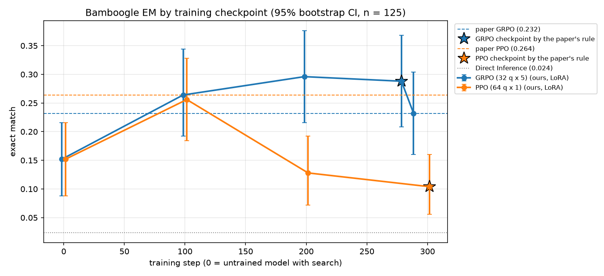
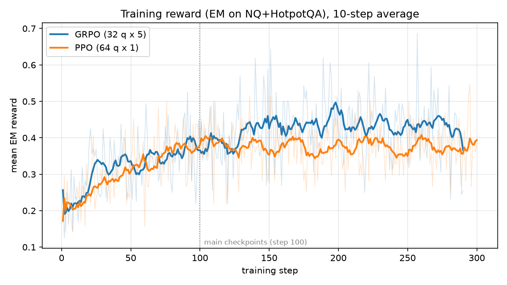
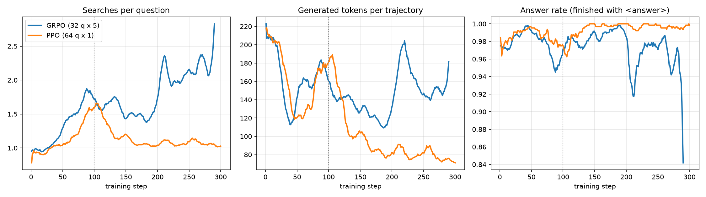
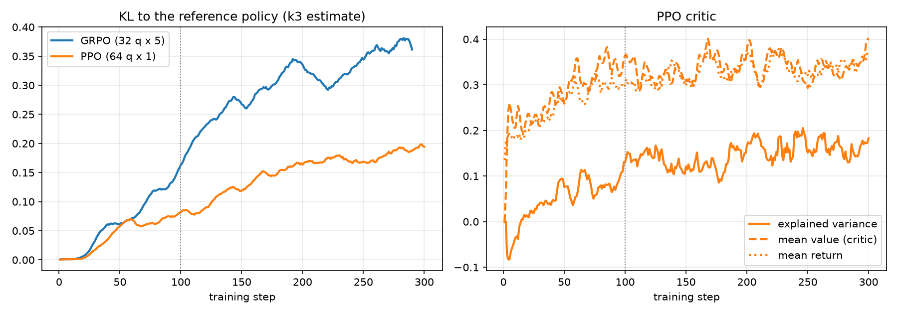

# Replicating Search-R1 with LoRA (Qwen2.5-3B-Instruct, Bamboogle)

This project replicates part of _Search-R1: Training LLMs to Reason and Leverage Search Engines
with Reinforcement Learning_ (Jin et al., 2025). It reproduces two rows of the paper's Table 2 on
Bamboogle for Qwen2.5-3B-Instruct:

- **Direct Inference**: no retrieval, no training.
- **Search-R1-Instruct**: RL-trained to interleave reasoning with search, with both GRPO and PPO, using LoRA (PEFT) instead of full fine-tuning.

## Results

The trained LoRA adapters are uploaded to HuggingFace at https://huggingface.co/zhantang00/search-r1-qwen2.5-3b-instruct-lora.

Exact match on all 125 Bamboogle questions. Each question is worth 0.008, so a 95% interval is about ±0.08 around a score near 0.25.

| Method                                     | Replication    | 95% CI      | Paper           |
| ------------------------------------------ | -------------- | ----------- | --------------- |
| Direct Inference                           | 0.024 (3/125)  | 0.000–0.056 | 0.024 (Table 2) |
| Search-R1 template, untrained (step 0)     | 0.152 (19/125) | 0.088–0.216 | -               |
| Search-R1-Instruct, GRPO (LoRA, 100 steps) | 0.264 (33/125) | 0.192–0.344 | 0.232 (Table 3) |
| Search-R1-Instruct, PPO (LoRA, 100 steps)  | 0.256 (32/125) | 0.184–0.328 | 0.264 (Table 2) |

Paired tests on the same 125 questions (exact McNemar):

| Comparison                   | Only first right | Only second right | p     |
| ---------------------------- | ---------------- | ----------------- | ----- |
| GRPO (step 100) vs untrained | 19               | 5                 | 0.007 |
| PPO (step 100) vs untrained  | 18               | 5                 | 0.011 |
| GRPO vs PPO (step 100)       | 10               | 9                 | 1.000 |

**Findings:**

1. Direct Inference reproduces exactly (3/125).
2. The paper’s values fall inside our 95% confidence intervals for both models. GRPO scores 0.264 against the paper's 0.232; PPO scores 0.256 against 0.264. Both beat the untrained model with search (p ≤ 0.011).
3. The paired test did not detect a difference between GRPO and PPO on these 125 questions (p = 1.0). This is consistent with the paper’s conclusion that both reach comparable performance.
4. Comparison with the authors' released checkpoints. Run through our evaluation code, they score 0.320 (GRPO) and 0.272 (PPO v0.3, close to Table 2's 0.264). Paired tests detected no significant difference from our step-100 models (p = 0.21 and 0.82, see `results/results.md`), although ours trained on the same training set but processed only 1.25% (GRPO, 3,200 questions) and 2.5% (PPO, 6,400 questions) as many questions as the paper (500 steps × 512 = 256,000). The two released checkpoints were evaluated before our closing-tag fix (see [Setup compared with the paper](#setup-compared-with-the-paper)).
5. Training longer (to step 300) exposed two failure modes the paper partly describes. GRPO destabilized after step 280, and PPO converged to a one-search strategy that coincided with lower Bamboogle accuracy. Choosing checkpoints with the paper's own rule gives GRPO 0.288 (step 280) and PPO 0.104 (step 300). See [Extended training](#extended-training-to-300-steps).

The step-100 runs are the primary results. Step 100 was the planned endpoint before the
extension, and both methods have the same step count there. The tables in
[`results/results.md`](results/results.md) list every evaluation and test.



## What the code does

| Component                   | Implementation                                                                                                                                                                                                                                                                                                                                            |
| --------------------------- | --------------------------------------------------------------------------------------------------------------------------------------------------------------------------------------------------------------------------------------------------------------------------------------------------------------------------------------------------------- |
| **Training data**           | The paper's processed NQ + HotpotQA training set                                                                                                                                                                                                                                                                                                          |
| **Test data**               | Bamboogle, 125 questions from the assignment CSV. Gold answers come from the authors' processed test split, which the paper used. The CSV adds one alternative answer on one question.                                                                                                                                                                    |
| **Prompt**                  | The authors' exact Search-R1 template, recovered from their training data (it differs slightly from the wording in the paper's Table 1)                                                                                                                                                                                                                   |
| **Retrieval**               | 2018 Wikipedia, `intfloat/e5-base-v2`, exact inner-product search, top 3. Checked with `retriever_check`: 6/6 of the paper's case-study queries return the paper's top hit, and the top 3 match faiss on 131/131 queries.                                                                                                                                 |
| **Rollout**                 | Up to 4 search turns plus a final turn. Generation stops at `</search>` or `</answer>`. Retrieved passages are inserted as `<information>…</information>` (at most 500 tokens), and any other output gets the authors' "action is invalid" message. Token IDs are kept exactly as sampled. Nothing is decoded and re-tokenized.                           |
| **Reward**                  | Exact match after normalization against any gold answer, using the last `<answer>` block in the response. No format reward. If a model never answers, that block can come from the inserted retry message (its example `<answer> and </answer>`). This always scores 0, the same as no answer, and shows up as the prediction "and" in 9 evaluation rows. |
| **Retrieved-token masking** | Inserted tokens (passages, retry messages) have loss mask 0. They are excluded from the policy loss, the KL term and the value loss, and only serve as context.                                                                                                                                                                                           |
| **GRPO**                    | 5 samples per question. Advantage = reward standardized within the group. Clipped surrogate (ε = 0.2) plus β·KL in the loss (β = 0.001, k3 estimator). Averaged over each trajectory's tokens, then over trajectories.                                                                                                                                    |
| **PPO**                     | KL-in-reward (β = 0.001). GAE with γ = λ = 1 over generated tokens only. Whitened advantages. Clipped surrogate. The critic is a LoRA copy of the base model with a zero-initialized value head, value clipping 0.5.                                                                                                                                      |
| **LoRA**                    | Rank 32, α 64, dropout 0, on all attention and MLP projections. The reference policy is the base model with the adapter disabled.                                                                                                                                                                                                                         |
| **Infrastructure**          | vLLM 0.32 for rollouts (the new adapter is loaded every step). Transformers + PEFT for training. Modal. Steps 1–100 ran on A100-80GB; the extension (steps 101–290 for GRPO, 101–300 for PPO) ran on H100.                                                                                                                                                |

## Setup compared with the paper

Most deviations come from time and budget constraints.

|                         | Paper                                                  | Replication                                                                                                                                                                                                                                                                                 | Reason                                                                  |
| ----------------------- | ------------------------------------------------------ | ------------------------------------------------------------------------------------------------------------------------------------------------------------------------------------------------------------------------------------------------------------------------------------------- | ----------------------------------------------------------------------- |
| Fine-tuning             | Full                                                   | LoRA (r 32, α 64)                                                                                                                                                                                                                                                                           | Assignment requirement                                                  |
| Policy learning rate    | 1e-6                                                   | 1e-5                                                                                                                                                                                                                                                                                        | LoRA usually needs about 10×                                            |
| Critic                  | Full model, learning rate 1e-5                         | LoRA + value head, learning rate 1e-4                                                                                                                                                                                                                                                       | LoRA                                                                    |
| Steps                   | 500                                                    | 100 (main), extension to 290 (GRPO) / 300 (PPO)                                                                                                                                                                                                                                             | Budget                                                                  |
| Prompts per step        | 512 for both                                           | 32 × 5 (GRPO), 64 × 1 (PPO)                                                                                                                                                                                                                                                                 | Budget                                                                  |
| Hardware                | 8×H100                                                 | 1 GPU, micro-batches of 4                                                                                                                                                                                                                                                                   | Budget                                                                  |
| Retrieved block         | Truncated to 500 tokens (can cut off `</information>`) | Passages truncated so the block keeps its closing tag (all our runs and step 0; the authors' checkpoints were evaluated with the original truncation)                                                                                                                                       | Truncation made models write fake passage text that would be trained on |
| Direct-inference prompt | Not published                                          | Our own (`DIRECT_TEMPLATE` in `rollout.py`); reproduces 0.024 exactly                                                                                                                                                                                                                       | Not specified by the paper                                              |
| Unspecified settings    | -                                                      | Value clip 0.5, whitened PPO advantages, gradient clip 1.0, constant learning rate after warmup (verl defaults); weight decay 0                                                                                                                                                             | Not specified by the paper                                              |
| Same as the paper       |                                                        | Data, retriever, top-3, action budget 4 (plus the official code's final answer turn), 500/500/4,096 token limits, temperature 1.0, top-p 1.0, β = 0.001, ε = 0.2, group of 5, γ = λ = 1, warmup ratios 0.285/0.015, 2 updates per batch, exact-match reward, masking, final-checkpoint rule |                                                                         |

## Training dynamics





**Steps 1–100 (the main runs).**

- **Reward:** training reward rose from about 0.21 to 0.38 for both methods. As in the paper, GRPO rose faster early on.
- **Search behavior:** both learned to search more, from about 0.95 to 1.6-1.8 searches per question.
- **Response length:** it showed the paper's decrease-then-increase pattern, going from about 210 to 115 tokens, then back to about 175.
- **Format:** after training, every Bamboogle response uses `<think>` tags (125/125, versus 101/125 before training), even though there is no format reward.
- **Sync check:** vLLM's logprobs stayed within about 0.006–0.03 of the trainer's, consistent with every rollout using the current adapter.

**PPO's critic stayed weak:** explained variance averaged about 0.15 after step 100. Single steps
reached 0.38, but the 10-step average never exceeded about 0.2. That is expected with a single 0/1
reward at the end of the trajectory, and with a small LoRA critic. With γ = λ = 1 and zero terminal bootstrap, GAE reduces to the remaining cumulative reward, including KL penalties, minus the estimated value. The critic’s low explained variance suggests limited predictive accuracy. This may reduce the effectiveness of variance reduction, although PPO still improved during the initial 100 steps.

## Extended training to 300 steps

| Checkpoint                   | Bamboogle EM | Searches / question | Answer rate | Hit turn limit |
| ---------------------------- | ------------ | ------------------- | ----------- | -------------- |
| GRPO step 100 (main)         | 0.264        | 1.82                | 0.99        | 1              |
| GRPO step 200                | 0.296        | 2.30                | 0.94        | 8              |
| GRPO step 280 (paper's rule) | 0.288        | 2.32                | 0.94        | 8              |
| GRPO step 290                | 0.232        | 3.59                | 0.59        | 51             |
| PPO step 100 (main)          | 0.256        | 1.89                | 0.95        | 6              |
| PPO step 200                 | 0.128        | 1.04                | 1.00        | 0              |
| PPO step 300 (paper's rule)  | 0.104        | 1.00                | 1.00        | 0              |

**Choosing checkpoints.** The paper evaluates the final checkpoint unless training diverged, in
which case it uses the most recent stable checkpoint according to the training-reward curve
(Appendix B). Applying that rule with training curves only: GRPO diverged after step 280, so the
rule picks step 280 (0.288). PPO's training reward never diverged, so it picks step 300 (0.104). The best observed score, GRPO at step 200 (0.296), is not selected as the primary result, because
choosing it would mean selecting on the test set. It is also not significantly better than step 100
(p = 0.54).

**GRPO: late instability.** Training reward kept improving to about 0.45 (steps 181–200) and held at
about 0.44 through step 280. Then, within nine steps, the answer rate fell from 1.00 to 0.61. The
policy began searching repeatedly until it ran out of turns. KL to the reference reached about 0.38, which is
twice PPO's. This is consistent with the paper’s report that GRPO becomes unstable after extended training. The run stopped at step 290 when the shared compute budget ran out.

Bamboogle shows the same timing. Step 280, just before the divergence, scored 0.288 with only 8
questions hitting the turn limit, the same profile as step 200. Ten steps later, at step 290, 51
questions hit the limit and the score fell to 0.232. This suggests the drop came from the last ten steps of instability rather than gradual degradation, though with three checkpoints from one run this is not conclusive.

**PPO: a shortcut that training reward cannot see.** After about step 100, PPO converged on a
single strategy: one search, which is often the question pasted as it is, then an answer.

- Searches per question fell from 1.56 to 1.04, and responses shrank from about 180 to 74 tokens.
- On Bamboogle, the first query equals the question for 75/125 questions at step 300, versus 17/125 at step 100.

**Training reward stayed flat at about 0.38**, which suggests a single search was often enough on the training questions. NQ is single-hop. HotpotQA (53% of the training set) is multi-hop, but many of its questions may be answerable from one retrieval. But Bamboogle is multi-hop:

- Bamboogle EM fell to 0.128 at step 200 and 0.104 at step 300.
- Both are worse than PPO at step 100.
- Both are back at the untrained model's level.

**Possible causes:**

- The reward doesn't separate the strategies. On NQ and HotpotQA training questions, one search is nearly as rewarding as decomposition.
- PPO's update signal is noisy. The critic barely reduced variance, and each step used only 64 trajectories.
- KL-in-reward penalizes length. PPO’s cumulative KL-in-reward penalty may encourage shorter trajectories, whereas GRPO’s per-token averaging reduces the penalty’s direct dependence on trajectory length. This difference could contribute to the observed behavior.
- GRPO may favor decomposition when it produces higher rewards than alternative sampled strategies.

## Example trajectories (Bamboogle)

**bamboogle_0**: _Who was president of the United States in the year that Citibank was founded?_
(gold: James Madison)

- **GRPO, step 100** (correct): searches _"When was Citibank founded?"_ → 1812, then _"Who was the
  president of the United States in 1812?"_ → answers **James Madison**.
- **PPO, step 300** (wrong): searches _"When was Citibank founded?"_ once and answers **1812**. It
  stops after the first hop.

**bamboogle_10**: _When was the company that built the first steam locomotive to carry passengers
on a public rail line founded?_ (gold: 1823)

- **GRPO, step 100** (correct): _"company built first steam locomotive to carry passengers on public
  rail line"_, then _"when was robert stephenson and company founded"_ → **1823**.
- **PPO, step 300** (wrong): one search with the question pasted verbatim → **1781**.

**bamboogle_2**: _In what year was the company that was founded as Sound of Music added to the S&P
500?_ (gold: 1999)

- **GRPO, step 100** (correct): three searches, the last _"Best Buy Co., Inc. S&P 500"_ → **1999**.
- **GRPO, step 290** (turn limit): _"Sound of Music company added to S&P 500"_ twice, then
  _"Sound of Music company S&P 500"_, then drifts to _"Comcast S&P 500 addition year"_ and never
  answers.

Every evaluation has two files in `results/eval/`:

- a `.jsonl` with one line per question: the question, gold answers, prediction, EM, number of searches and turns, how the trajectory finished, and the full response
- a `.summary.json` with EM, the 95% CI and averages

| File name                                      | Run                                                |
| ---------------------------------------------- | -------------------------------------------------- |
| `direct`                                       | Direct Inference (no retrieval)                    |
| `step0`                                        | Search-R1 template, untrained model                |
| `grpo`, `ppo`                                  | Main results: GRPO and PPO at step 100             |
| `grpo_step200`, `grpo_step280`, `grpo_step290` | GRPO extension                                     |
| `ppo_step200`, `ppo_step300`                   | PPO extension                                      |
| `official_grpo`, `official_ppo_v03`            | Authors' released checkpoints, our evaluation code |

For example, the trajectories quoted above are in `grpo.jsonl`, `ppo_step300.jsonl` and `grpo_step290.jsonl`, under ids `bamboogle_0`, `bamboogle_10` and `bamboogle_2`. Sample trajectories logged during training are in `results/samples/`.

## Limitations

- Bamboogle is small (n = 125, ±0.08), and each method was trained once (one seed).
  We use paired tests to assess differences. Confidence intervals reflect question-level uncertainty, not training-seed variability.
- Training scale: 1.25–2.5% of the paper's training questions in the main runs, LoRA instead of
  full fine-tuning, and unequal prompts per step for GRPO and PPO.
- Checkpoint selection follows the paper's training-reward rule, which cannot detect
  out-of-domain regressions (see the PPO results).
- Only Bamboogle was evaluated.

## Reproducing

```bash
pip install modal && modal setup
modal run --detach modal_app.py::download_assets             # data, models, corpus, index
modal run modal_app.py::evaluate --mode direct                # Direct Inference
modal run modal_app.py::retriever_check                       # retrieval sanity checks
modal run modal_app.py::search_evals                          # step 0 + checkpoints
modal run --detach modal_app.py::train --preset grpo          # GRPO, 100 steps
modal run --detach modal_app.py::train --preset ppo           # PPO, 100 steps
modal run modal_app.py::evaluate --mode search --name grpo --adapter /vol/runs/grpo/ckpt/step_0100/policy
modal run modal_app.py::evaluate --mode search --name ppo  --adapter /vol/runs/ppo/ckpt/step_0100/policy
# extension: resume to 300 steps, then evaluate checkpoints
modal run --detach modal_app.py::train --preset grpo --steps 300 --run-name grpo
modal run --detach modal_app.py::train --preset ppo  --steps 300 --run-name ppo
modal run modal_app.py::eval_checkpoints --runs grpo --steps 200,280,290
modal run modal_app.py::eval_checkpoints --runs ppo  --steps 200,300
# figures and tables, run locally (needs: pip install matplotlib)
# after downloading eval/ and runs/<run>/metrics.jsonl from the Volume into results/
python plots.py
```

## Files

```text
week_08/
├── modal_app.py                      # Modal image, Volume and every entry point (download, retriever, evaluate, train)
├── config.py                         #paths, resource names, Config dataclass and presets
├── data.py                           # data preparation (NQ+HotpotQA, Bamboogle, prompt template), model and corpus downloads
├── retriever.py                      # E5 encoder, exact top-k search, corpus lookup, passage formatting
├── rollout.py                        # Trajectory, prompts, multi-turn Search-R1 rollout with loss masks
├── scoring.py                        # answer extraction, normalization, exact match
├── algorithms.py                     # GRPO/PPO math: advantages, GAE, clipped losses, KL, value loss (with self-tests)
├── train.py                          # training loop (GRPO and PPO), LoRA sync to vLLM, checkpoint/resume
├── evaluate.py                       # Bamboogle evaluation, per-question outputs, bootstrap CIs
├── plots.py                          # figures and results/results.md (paired McNemar tests)
├── results/                          # eval/ (per-question outputs + summaries), metrics/, samples/, results.md
├── figures/                          # fig1–fig4
├── Bamboogle_Prerelease_-_Sheet1.csv # Bamboogle dataset
├── requirements.txt                  # dependencies
└── README.md                         # this file
```
